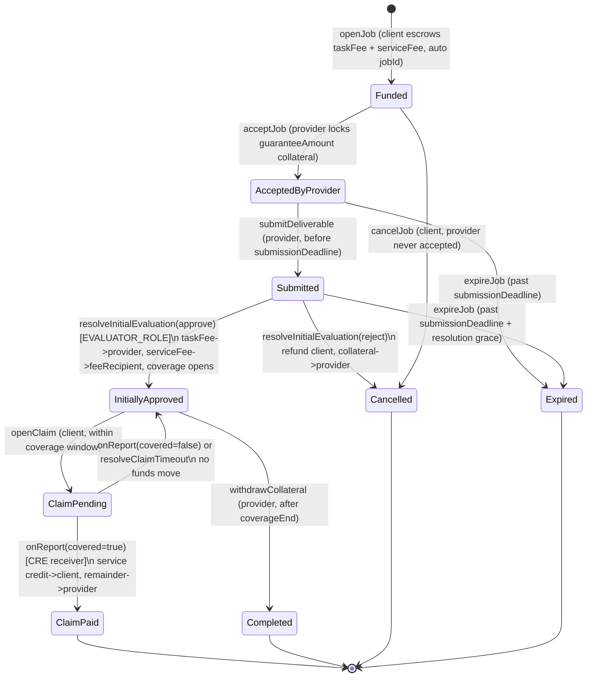
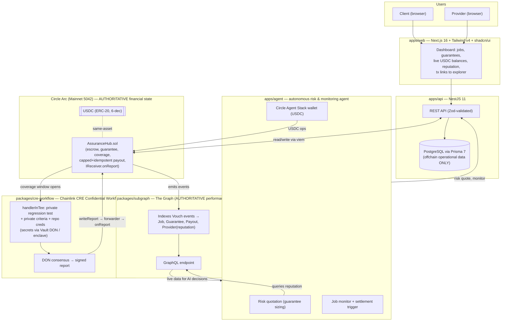

# Vouch — Confidential Outcome-Assurance Protocol

Vouch lets an AI-coding provider post a **capped, self-funded performance guarantee** that a
**confidential regression test** can trigger *after* the job is paid — turning point-in-time
acceptance into durable, onchain-priced accountability.

**Live on Circle Arc mainnet** (chain id `5042`) — the full lifecycle, including a covered claim
settled in USDC, is proven with real mainnet transactions.

---

## Live proof (Arc mainnet)

| | |
|---|---|
| **Deployed app** | [`https://withvouch.xyz`](https://withvouch.xyz) — API `https://api.withvouch.xyz`, agent `https://agent.withvouch.xyz` |
| **Review in one command** | `docker compose up` — boots the stack and serves the dashboard + `/health` against the live Arc deployment (browse + read-live; click-through mutation needs a funded browser wallet + SIWE). |
| **Network** | Circle **Arc mainnet**, chain id **`5042`** (`eip155:5042`) · explorer [`explorer.arc.io`](https://explorer.arc.io) · USDC predeploy `0x3600…0000` |
| **`AssuranceHub`** (settlement) | [`0xB30e054557533f28753B4ACdf646B393E2072bf9`](https://explorer.arc.io/address/0xB30e054557533f28753B4ACdf646B393E2072bf9) · deploy [`0x5872bad6…`](https://explorer.arc.io/tx/0x5872bad67b2835a53a0a28b92b3da5829455dfc5a9232be5ed6b8f9cd98b5b6d) · block `25456280` |
| **`QuoteBondEscrow`** (agent bond) | [`0x3ca2d854D5f042dd0ddd39Eaf80644be0e80048c`](https://explorer.arc.io/address/0x3ca2d854D5f042dd0ddd39Eaf80644be0e80048c) · deploy [`0x7e4395c4…`](https://explorer.arc.io/tx/0x7e4395c4cdc76360b90f24a2c425f191f218c8ca0f602e4c7cb26f362f2e75b7) · block `25456336` |

The full end-to-end lifecycle — covered claim settled to `ClaimPaid` — is **proven with live mainnet
transactions** (see the [lifecycle table](#live-lifecycle-transactions-arc-mainnet) and
[live coordinates](#live-coordinates-arc-mainnet)). Full public record:
[`docs/DEPLOYMENT.md`](docs/DEPLOYMENT.md).

---

## The problem

Acceptance tests are a **point-in-time** signal. An AI coding change can pass the public test suite,
be accepted, and be paid for — then be revealed as defective by a regression that only a **private**
or **later-run** test detects. Once the fee is released, the client has no recourse and the provider
bears no consequence.

**Ordinary escrow does not close this gap.** Escrow releases funds *on acceptance* and then the
relationship is over — it has no notion of a window after payment during which a fault can still be
proven, and it cannot adjudicate a failure that only a *confidential* test can see (revealing the
test would destroy its value). Vouch's novelty is exactly that missing piece: a **post-acceptance
coverage window** plus a **confidential trigger**.

---

## The solution

A **provider voluntarily** attaches a **provider-funded, capped performance guarantee** to a job.
After the task fee is paid on public-test acceptance, a **coverage window** opens during which a
**confidential regression test running in a Chainlink CRE TEE** can prove a covered failure and
trigger a **capped service-credit payout** to the client. The verdict becomes **onchain
reputation**, indexed by The Graph, so the provider's next quote prices in its own track record.

Vouch is **not** a marketplace, **not** general insurance (no pools, no third-party premiums), and
**not** ordinary escrow. It composes exactly three technologies — authoritative onchain settlement
(Arc), confidential compute (CRE), and indexed reputation (The Graph) — and nothing else.

### Canonical 6-step flow

1. **Client funds** a coding job — `openJob` escrows `taskFee + serviceFee`.
2. **Provider locks** capped guarantee collateral — `acceptJob`.
3. **Public tests pass** → evaluator approves → the **task fee releases** and a **coverage window
   opens** (`resolveInitialEvaluation` → `CoverageStarted`).
4. A **confidential regression test runs inside the CRE TEE** during coverage.
5. A **covered failure is proven** → capped guarantee paid to the client (`onReport` →
   `GuaranteePaid`).
6. The **verdict is indexed by The Graph** → provider reputation updates → the next quote prices it
   in.

---

## Integrations

Three integrations, each load-bearing. Every row links to a live transaction, endpoint, or committed
file.

| Integration | What Vouch does | Verifiable evidence |
|---|---|---|
| **Circle Arc + USDC** | Foundry contracts (`AssuranceHub`, `QuoteBondEscrow`) live on Arc mainnet (chain `5042`). All escrow, guarantee collateral, and the capped + idempotent payout settle in native **USDC** (the 6-decimal ERC-20 view of the Arc gas asset — the same funds, never two balances). | Contracts above · full covered-claim lifecycle settled on mainnet (see [lifecycle table](#live-lifecycle-transactions-arc-mainnet)). |
| **Circle Agent Stack** | A policy-bound Circle **developer-controlled wallet** (`apps/agent/src/wallet/agentWallet.ts`, contract-execution-only, per-tx/daily caps + destination allowlist) autonomously posts and refunds a reputation-priced quote-bond. The agent is **transport, never authority** — it never moves guarantee principal (`apps/agent/src/index.ts:67-71`). | Autonomous bond round-trip demonstrated on testnet: `postBond` [`0x5d9d1af8…`](https://testnet.arcscan.app/tx/0x5d9d1af8a0516fbf588e9962bcc4928c40a088e820d15707c2be10adfded040a) · refund [`0xd668c466…`](https://testnet.arcscan.app/tx/0xd668c466666465d5db9360218c220c9cbc76f212961946ab51a0ea5404909fd4). |
| **The Graph** | `packages/subgraph` (13 entities, 13 handlers) indexes `AssuranceHub` into provider reputation. The agent's risk quote (`apps/agent/src/graph/client.ts` → `getProviderRisk`) is a **pure function of indexed data** — no onchain aggregate, no DB mirror, no fixture (ADR-003), fail-closed if the index is stale/lagging/unavailable. | Arc mainnet subgraph (`network: arc`) synced from block `25456280`: endpoint [`api.studio.thegraph.com/query/1760065/vouch/v0.1.0`](https://api.studio.thegraph.com/query/1760065/vouch/v0.1.0) · CID `QmViL5UHhMLLTZLBxwXP235uKKPbnAWhZPuhK1BtfV5z1x`. Indexed: job `0x01` → `CLAIM_PAID`, provider `claimsUpheld=1`, `hasIndexingErrors: false`. 12 Matchstick tests + `packages/subgraph/scripts/health-check.mjs`. |
| **Chainlink CRE** | `packages/cre-workflow` runs the private regression test inside a real `handlerInTee<…>` (`@chainlink/cre-sdk@1.20.1`, Nitro TEE, Vault DON secrets). Repo token, pass-threshold, and private test stay inside the enclave; only the 7-tuple verdict is declassified → `writeReport` → `AssuranceHub.onReport` → capped `min(amount, guaranteeAmount)`. | Live `cre workflow simulate` → **`REPORTED:PAYOUT`** in [`docs/evidence/simulate-cli-payout.txt`](docs/evidence/simulate-cli-payout.txt) + deterministic harness + sha256 `MANIFEST`. Covered-claim onchain settlement proven on mainnet: `onReport` → `GuaranteePaid` → [`ClaimPaid`](https://explorer.arc.io/tx/0x54a314dbd7ea7b984db7e04db536a12f614c68c8b7c0469a7f631875afab2fbf). |

---

## Live coordinates (Arc mainnet)

Full public record: [`docs/DEPLOYMENT.md`](docs/DEPLOYMENT.md).

| Coordinate | Value |
|---|---|
| Chain id | `5042` (`eip155:5042`) |
| Explorer | [`https://explorer.arc.io`](https://explorer.arc.io) |
| RPC | `https://rpc.drpc.mainnet.arc.io` |
| `AssuranceHub` | [`0xB30e054557533f28753B4ACdf646B393E2072bf9`](https://explorer.arc.io/address/0xB30e054557533f28753B4ACdf646B393E2072bf9) |
| `QuoteBondEscrow` | [`0x3ca2d854D5f042dd0ddd39Eaf80644be0e80048c`](https://explorer.arc.io/address/0x3ca2d854D5f042dd0ddd39Eaf80644be0e80048c) |
| USDC (official Arc predeploy) | [`0x3600000000000000000000000000000000000000`](https://explorer.arc.io/address/0x3600000000000000000000000000000000000000) |
| Subgraph query endpoint | [`https://api.studio.thegraph.com/query/1760065/vouch/v0.1.0`](https://api.studio.thegraph.com/query/1760065/vouch/v0.1.0) |
| Deploy block / subgraph `startBlock` | `25456280` |
| Operator EOA (deployer, all roles) | [`0x9A39bC6C499C4f51336692871233164Ae621D52E`](https://explorer.arc.io/address/0x9A39bC6C499C4f51336692871233164Ae621D52E) |
| CRE identity | `workflowId = keccak256("vouch-assurance-v1")`, `workflowName = "vouchclaim"` |

> USDC on Arc is a 6-decimal ERC-20 view of the 18-decimal native gas asset — the **same funds**,
> never two balances.

### Live lifecycle transactions (Arc mainnet)

Full happy-path + covered-failure settlement, end-to-end on Arc mainnet (jobId 1). Task fee +
guarantee `0.05` USDC each; final state `ClaimPaid`, hub escrow balance 0, both wallets net-zero
principal (gas only).

| Step | Result | Tx |
|---|---|---|
| `openJob` (escrow task fee) | Funded | [`0x2836084b…`](https://explorer.arc.io/tx/0x2836084bdc69c9648068245d00603a318602cf1cd58482400043f0280939d37c) |
| `acceptJob` (lock collateral) | AcceptedByProvider | [`0x3430c18d…`](https://explorer.arc.io/tx/0x3430c18d78d9dedd4d204c1d756b5654e4697410d82ef667a5b7da5cef199109) |
| `submitDeliverable` | Submitted | [`0xf791bb6a…`](https://explorer.arc.io/tx/0xf791bb6a4a68fb6ef2b7837a371c9bfe9745a13879872c80450df73b0aaf76cf) |
| `resolveInitialEvaluation(true)` | InitiallyApproved — task fee released, coverage opens | [`0x94bf13c2…`](https://explorer.arc.io/tx/0x94bf13c2f323da57a953e2e51c8a36fae43bf00f9cf666014830a93ad30f836c) |
| `openClaim` | ClaimPending | [`0x7d6bbd14…`](https://explorer.arc.io/tx/0x7d6bbd14d29a8d8283d2a9feb6f106a3a833ae4a774b667b92b5d1f917953bed) |
| `onReport(covered, 0.05)` | **ClaimPaid** — `GuaranteePaid` to client | [`0x54a314db…`](https://explorer.arc.io/tx/0x54a314dbd7ea7b984db7e04db536a12f614c68c8b7c0469a7f631875afab2fbf) |

> The testnet deployment (chain `5042002`) remains on record in [`docs/DEPLOYMENT.md`](docs/DEPLOYMENT.md)
> for the earlier lifecycle, no-claim, and autonomous agent-bond demonstrations.

---

## Architecture

Full treatment (state machine, data flow, ADRs): [`docs/architecture.md`](docs/architecture.md).
Exported diagram: [`docs/diagrams/architecture.png`](docs/diagrams/architecture.png).

### Protocol state machine



### Component / data flow



### Authority model (condensed)

Full detail in [`docs/architecture.md`](docs/architecture.md) §3 and [`docs/security.md`](docs/security.md).

| Concern | Authoritative store | Notes |
|---|---|---|
| Escrow, service fee, guarantee collateral, payouts | Arc `AssuranceHub` | Capped, idempotent, receiver-gated payout |
| Provider reputation / performance history | The Graph subgraph | Derived from minimal onchain events; no onchain aggregate |
| UI cache, orchestration metadata, sessions | Postgres / Prisma | **Operational only** — rebuildable, never money/reputation |
| Private tests, criteria, repo credentials | CRE TEE (Vault DON) | Confidential from node operators; only a verdict leaves |

`AssuranceHub` composes `ReceiverBase, AccessControl, Pausable, ReentrancyGuard`. Authority is split
across three surfaces: **`DEFAULT_ADMIN_ROLE`** (config/role only — timelocked forwarder/workflow
changes, `pause`, `setFeeRecipient`; **can never seize principal**, machine-checked by
`test_NoAdminCanSeizeFunds`), **`EVALUATOR_ROLE`** (public approve/reject only), and the **CRE
receiver** (`onReport` — the only claim-finalizing path, gated by forwarder + packed workflow
identity). Pausable pauses **entries, never exits**, so no rightful funds are ever trapped.

---

## Security & trust model

> ### Trust model & what's simulated
> These are **deliberate design boundaries**, stated up front rather than discovered in Q&A. Full
> treatment: [`docs/security.md`](docs/security.md).
>
> - **Settlement is a trusted-relay path, not yet trust-minimized.** Arc exposes no canonical
>   KeystoneForwarder, so `onReport` authorizes on `msg.sender == forwarder` + workflow identity —
>   there is **no on-chain DON-signature verification yet**. Whoever holds the forwarder key could
>   forge a `covered=true` report (bounded by `amount ≤ guaranteeAmount` + recipient binding). This
>   is **agent-as-transport**, not attested settlement.
> - **Simulate ≠ attested.** The CRE `simulate` PAYOUT is a single local node — proof the workflow
>   logic and gating work end-to-end, **not** proof of a Nitro attestation. The TEE guarantees
>   **confidentiality of inputs**, not attested integrity of the output. A live enclave deploy still
>   needs private-beta enrollment; simulate is the accepted evidence today.
> - **The agent is transport, never authority.** It quotes and posts operational bonds autonomously,
>   but it **never moves guarantee principal** and can never forge a valid settlement.
> - **The Graph is queried via Subgraph Studio**, a centralized dev endpoint — the freshness-gated,
>   load-bearing reputation source, but not a decentralized indexer.
>
> **Roadmap** closes each of these: an attested-DON forwarder path, on-chain signature verification,
> and a decentralized-network subgraph.

**The money-safety part is strong and tested:** payout is capped (`min(amount, guaranteeAmount)`),
settlement is idempotent (`settled`/`claimFiled` latches → replayed reports are no-ops), reports are
domain-bound (`chainId + hub`), the solvency invariant `usdc.balanceOf(hub) ≥ totalLiabilities`
holds at every state (fuzzed + exact-conservation tested), and the API only marks a tx final after
`confirmations ≥ 3` **and** an arg-hash + expected-event match.

---

## Technology stack

- **Contracts:** Solidity + **Foundry** (`AssuranceHub`, `QuoteBondEscrow`) on Circle **Arc**.
- **Indexing:** **The Graph** (subgraph, AssemblyScript handlers, Matchstick tests) via Subgraph Studio.
- **Confidential compute:** **Chainlink CRE** Confidential Workflow, `@chainlink/cre-sdk@1.20.1`
  (`handlerInTee`, Nitro TEE, Vault DON secrets).
- **Web:** **Next.js 16** + Tailwind v4 + shadcn/ui (`apps/web` app, `apps/landing` marketing).
- **API:** **NestJS 11**, Zod-validated, CORS-scoped, ThrottlerGuard, fail-closed env.
- **Agent:** **Fastify** + Circle **developer-controlled wallets** + an MCP server
  (`apps/agent/src/server/mcp.ts`).
- **Data:** **Prisma 7** / PostgreSQL (offchain operational only). **viem** for chain I/O.
- **Monorepo:** **pnpm** + **Turborepo**.

### Monorepo layout

| Path | Package | Responsibility |
|---|---|---|
| `apps/web` | `@vouch/web` | Next.js 16 dashboard: jobs, guarantees, live USDC balances, reputation, tx links. |
| `apps/landing` | `@vouch/landing` | Standalone marketing site (`withvouch.xyz`). |
| `apps/api` | `@vouch/api` | NestJS 11 REST API. **Offchain operational data only.** |
| `apps/agent` | `@vouch/agent` | Fastify autonomous risk-quotation + job-monitoring agent + MCP server. **Never settles guarantee funds.** |
| `packages/contracts` | `@vouch/contracts` | Foundry contracts on Arc — authoritative financial state. |
| `packages/subgraph` | `@vouch/subgraph` | The Graph subgraph — authoritative reputation history. |
| `packages/cre-workflow` | `@vouch/cre-workflow` | Chainlink CRE Confidential Workflow (TEE). The **only** place private tests/criteria/creds live. |
| `packages/shared` | `@vouch/shared` | Zod schemas, types, chain constants, ABIs, logger, errors. |
| `packages/config` | `@vouch/config` | Shared TS / ESLint / Prettier config. |
| `packages/ui` | `@vouch/ui` | shadcn/ui primitives shared across apps. |
| `packages/db` | `@vouch/db` | Prisma 7 client. Offchain operational data only — never money/reputation/secrets. |

---

## Local setup

Requires **Node 22** (see `.nvmrc`) and **pnpm**; contracts additionally require **Foundry**
(`forge`).

```bash
pnpm install

# copy env templates (no real values ship in the repo)
cp .env.example .env
cp .env.development.example .env.development
# per-environment templates: .env.arc-testnet.example, .env.arc-mainnet.example
```

**One-command review:** `docker compose up` boots the stack and serves the dashboard + `/health`
against the live Arc deployment (browse + read-live). Click-through mutation additionally needs a
funded browser wallet + SIWE sign-in.

---

## Test commands

| Script | Action |
|---|---|
| `pnpm dev` | Run all apps in dev (`turbo run dev`). |
| `pnpm build` | Build all packages/apps. |
| `pnpm lint` | Lint the workspace. |
| `pnpm typecheck` | Strict TypeScript typecheck. |
| `pnpm test` | Run unit tests. |
| `pnpm test:contracts` | Foundry contract tests (`forge test` in `packages/contracts`). |
| `pnpm test:e2e` | End-to-end tests. |
| `pnpm gate:secrets` | Secret-leak gate (fails closed; also runs the CRE harness as a positive control). |
| `pnpm demo:health` | Live health check against the deployment. |

---

## What's built

- **`AssuranceHub` + `QuoteBondEscrow`** deployed live to **Arc mainnet** (chain `5042`) with the
  full lifecycle (escrow, capped/idempotent payout, coverage window, receiver-gated settlement)
  proven by real mainnet transactions, including a covered claim settled to `ClaimPaid`.
- **The Graph subgraph** (13 entities, 13 handlers, 12 Matchstick tests) deployed to Subgraph Studio
  on the `arc` mainnet network, driving a **pure-function risk quote** that is fail-closed on stale
  data.
- **Circle Agent Stack wallet** posting and refunding a real reputation-priced quote-bond
  autonomously, with policy caps + allowlist.
- **Chainlink CRE Confidential Workflow** with a real `handlerInTee`, enclave secrets, and a live
  `cre workflow simulate` producing `REPORTED:PAYOUT` — plus a deterministic harness and sha256
  manifest; the covered-claim settlement path (`onReport`) is proven on mainnet.
- **End-to-end reputation loop:** an upheld claim indexed by The Graph raises the provider's risk and
  makes the next agent quote measurably more expensive.
- Web dashboard, standalone landing site, NestJS API, and the fail-closed security posture
  (confirmation discipline, secret gate, timelocked admin).

---

## Limitations

Stated plainly; each is a design boundary, not a surprise (see [`docs/security.md`](docs/security.md) §3, §6).

- **Trusted-relay settlement** — no on-chain DON-signature verification yet (see trust box).
- **CRE live enclave deploy needs private-beta enrollment** — `simulate` is the accepted evidence today.
- **The agent never auto-posts the guarantee bond** — `JobCreated` carries no `quoteId`; the
  autonomous onchain action is the operational quote-bond only.
- **Reputation exists only as indexed Graph data** — no onchain aggregate; a consumer pointed at a
  stale/wrong subgraph reads wrong history (freshness gate mitigates).
- **Partial credit is reserved / integration-dead** — the live CRE path always emits
  `amount == guaranteeAmount`.

---

## Future roadmap

- **Attested-DON settlement path** on Arc: canonical forwarder + **on-chain DON-signature
  verification**, removing the trusted-relay assumption.
- **Nitro attestation checked on-chain** before a verdict is trusted (input *and* output integrity).
- **Decentralized-network subgraph** beyond the Studio dev endpoint.
- Broader verticals beyond AI coding for the confidential post-acceptance coverage primitive.

---

## License

MIT — see [`LICENSE`](LICENSE).
